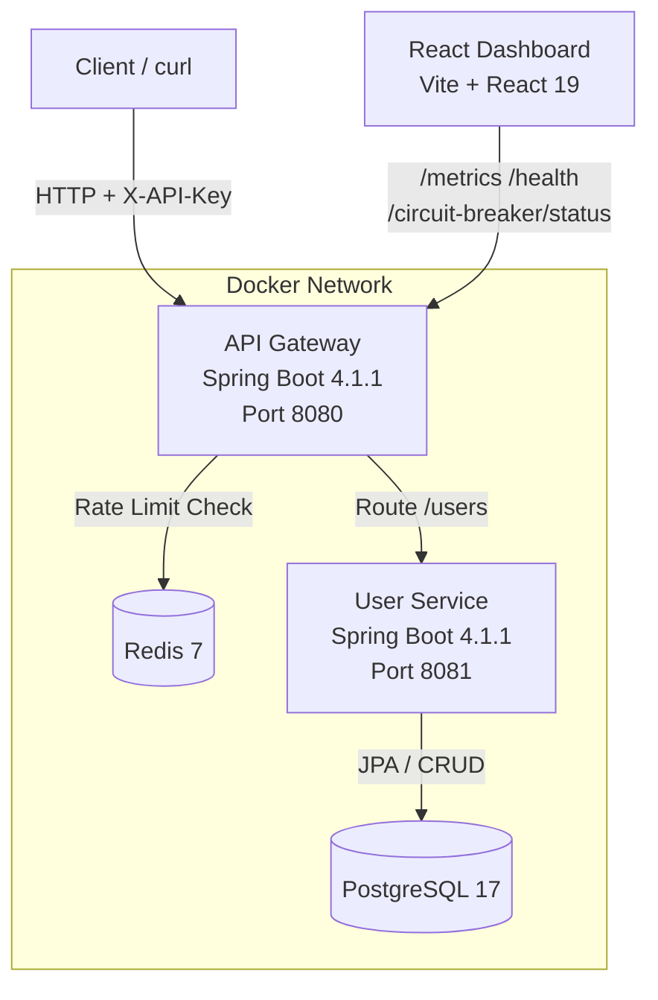

# Smart API Gateway & Reliability Platform

A production-ready API gateway that provides centralized routing, authentication, rate limiting, automatic retries, circuit-breaker protection, and real-time observability for downstream microservices.

## Problem Statement

In a microservices architecture, each client must handle authentication, retries, rate limiting, and fault tolerance individually. This project centralizes these cross-cutting concerns in a single API gateway so that downstream services stay simple and the platform remains reliable under failure conditions.

## Architecture



## Technology Stack

| Component | Technologies |
|---|---|
| **API Gateway** | Spring Boot 4.1.1, Spring Cloud Gateway Server WebMVC (2025.1.3), Resilience4j 2.3.0, Spring Data Redis, Spring Boot Actuator |
| **User Service** | Spring Boot 4.1.1, Spring Data JPA, PostgreSQL driver |
| **Dashboard** | React 19, Vite 8, JSX |
| **Infrastructure** | Docker Compose, PostgreSQL 17, Redis 7, Eclipse Temurin Java 25 |

## Implemented Features

### API-Key Authentication
Every request to the gateway must include the `X-API-Key` header. Requests without a valid key receive `401 Unauthorized`. Health and fallback endpoints are exempt.

### Rate Limiting
Redis-backed sliding-window rate limiter: **100 requests per minute per client IP**. Exceeding the limit returns `429 Too Many Requests` with a `Retry-After` header.

### Automatic Retries
The gateway automatically retries failed GET requests to the user service up to **2 additional attempts** with exponential backoff (100ms–500ms) on server errors (5xx).

### Circuit Breaker
Resilience4j circuit breaker (`usersCircuit`) protects the user-service route:
- **Sliding window:** 10 calls (count-based)
- **Minimum calls:** 5 before evaluation
- **Failure threshold:** 50%
- **Open state duration:** 10 seconds
- **Half-open permitted calls:** 3
- When open, requests receive `503 Service Unavailable` with a JSON error body and `Retry-After: 10` header.

### Request Logging & History
Every request is logged to the console with method, path, status code, and duration. The last **100 requests** are stored in memory and exposed via `/api/requests`.

### Metrics
Real-time request counters exposed at `/metrics`:
- `totalRequests`, `successfulRequests`, `failedRequests`, `totalRetries`

### CORS
Configured for `http://localhost:5173` (the React dashboard dev server) with support for GET, POST, PUT, DELETE, and OPTIONS methods.

### React Dashboard
A live monitoring dashboard (`gateway-dashboard/`) that auto-refreshes every 5 seconds, showing:
- Request analytics (total, successful, failed, success rate)
- Service health status (gateway + user service)
- Circuit breaker state and metrics
- Response time performance chart
- Filterable request history table

## Prerequisites

- **Docker Desktop** installed and running
- **Docker Compose** v2 (bundled with Docker Desktop)
- **PowerShell** or any terminal with `curl` access
- At least **2 GB of free RAM** for running all four containers

## Docker Setup

### 1. Configure environment variables

Copy the example environment file and set your credentials:

```powershell
copy .env.example .env
```

Edit `.env` and replace the placeholder values with your desired credentials. The `.env` file is git-ignored and will not be committed.

### 2. Clone and start

```powershell
cd "<path-to-project>"
docker compose up -d --build
```

Docker Compose will automatically read the values from `.env`.

This builds and starts four containers:

| Service | Container Name | Host Port | Container Port |
|---|---|---|---|
| API Gateway | `smart-api-gateway-deploy` | `8083` | `8080` |
| User Service | `smart-api-user-service-deploy` | `8082` | `8081` |
| PostgreSQL | `smart-api-postgres-deploy` | `5433` | `5432` |
| Redis | `smart-api-redis-deploy` | `6380` | `6379` |

### 2. Wait for startup

The gateway depends on the user service, which waits for PostgreSQL and Redis to become healthy. Allow ~30 seconds for all services to start.

```powershell
docker ps --filter "name=smart-api"
```

All four containers should show `Up` status, with PostgreSQL and Redis marked as `healthy`.

### 3. Stop and clean up

```powershell
docker compose down
```

To also remove the PostgreSQL data volume:

```powershell
docker compose down -v
```

## Endpoints

### API Gateway (port 8083 via Docker)

| Endpoint | Method | Auth | Description |
|---|---|---|---|
| `/users` | GET | Required | Routes to user-service, returns list of users |
| `/users` | POST | Required | Creates a new user (routed to user-service) |
| `/health` | GET | Not required | Gateway health check |
| `/actuator/health` | GET | Not required | Spring Boot Actuator health |
| `/metrics` | GET | Required | Request counters (total, success, failure, retries) |
| `/api/requests` | GET | Required | Last 100 recorded requests |
| `/circuit-breaker/status` | GET | Required | Circuit breaker state and metrics |
| `/fallback/users` | GET | Not required | Fallback response when circuit is open |

### User Service Direct (port 8082 via Docker)

| Endpoint | Method | Description |
|---|---|---|
| `/users` | GET | Returns all users (empty array `[]` if no records exist) |
| `/users` | POST | Creates a new user |
| `/users/slow-test` | GET | Returns after 300ms delay (for testing) |

## Testing with PowerShell

### Successful request (with API key)

```powershell
curl.exe -H "X-API-Key: YOUR_API_KEY" http://localhost:8083/users
```

Replace `YOUR_API_KEY` with the value you set in `.env` (`GATEWAY_API_KEY`).

Expected: `[]` (empty JSON array — no user records exist by default).

### Missing API key

```powershell
curl.exe http://localhost:8083/users
```

Expected: `401 Unauthorized. Invalid or missing API key.`

### Wrong API key

```powershell
curl.exe -H "X-API-Key: wrong-key" http://localhost:8083/users
```

Expected: `401 Unauthorized. Invalid or missing API key.`

### Full HTTP headers

```powershell
curl.exe -i -H "X-API-Key: YOUR_API_KEY" http://localhost:8083/users
```

Expected: `HTTP/1.1 200 OK` with `Content-Type: application/json`.

### Create a user

```powershell
curl.exe -X POST -H "X-API-Key: YOUR_API_KEY" -H "Content-Type: application/json" -d '{"name":"John Doe","email":"john@example.com"}' http://localhost:8083/users
```

### Health checks

```powershell
# Gateway custom health
curl.exe http://localhost:8083/health

# Spring Boot Actuator
curl.exe http://localhost:8083/actuator/health

# Direct user-service
curl.exe http://localhost:8082/users
```

### Circuit breaker status

```powershell
curl.exe -H "X-API-Key: YOUR_API_KEY" http://localhost:8083/circuit-breaker/status
```

Expected: JSON with `name`, `state` (CLOSED/OPEN/HALF_OPEN), `failureRate`, `bufferedCalls`, `failedCalls`, `successfulCalls`.

### Metrics

```powershell
curl.exe -H "X-API-Key: YOUR_API_KEY" http://localhost:8083/metrics
```

Expected: JSON with `totalRequests`, `successfulRequests`, `failedRequests`, `totalRetries`.

### Request history

```powershell
curl.exe -H "X-API-Key: YOUR_API_KEY" http://localhost:8083/api/requests
```

Expected: JSON array of the last 100 requests with `method`, `path`, `statusCode`, `durationMs`, `timestamp`.

## Running the Dashboard

The React dashboard is a separate project in `gateway-dashboard/`. It connects to the gateway at `http://localhost:8080` (local development) and requires the gateway to be running.

```powershell
cd gateway-dashboard
npm install
npm run dev
```

The dashboard opens at `http://localhost:5173` and auto-refreshes every 5 seconds.

> **Note:** When using Docker, the dashboard connects to the local gateway port. Set `VITE_API_URL=http://localhost:8083` in a `.env` file inside `gateway-dashboard/` or pass it when running `npm run dev`.

## Configuration

### Gateway Environment Variables

| Variable | Default | Description |
|---|---|---|
| `GATEWAY_API_KEY` | _(required)_ | API key for authentication — set in `.env` |
| `GATEWAY_USER_SERVICE_URL` | `http://localhost:8081` | Downstream user-service URL |

### Database (User Service)

| Variable | Default | Description |
|---|---|---|
| `SPRING_DATASOURCE_URL` | `jdbc:postgresql://localhost:5432/smartapi` | PostgreSQL connection URL |
| `SPRING_DATASOURCE_USERNAME` | `anas` | Database username — override with `DB_USERNAME` in `.env` |
| `SPRING_DATASOURCE_PASSWORD` | _(required)_ | Database password — set in `.env` as `POSTGRES_PASSWORD` |

### Redis

| Variable | Default | Description |
|---|---|---|
| `SPRING_DATA_REDIS_HOST` | `localhost` | Redis host |
| `SPRING_DATA_REDIS_PORT` | `6379` | Redis port |

In Docker, these are set automatically via `docker-compose.yml` and `application-docker.properties`.

## Project Structure

```
Smart API Gateaway/
├── api-gateaway/                 # API Gateway service
│   ├── Dockerfile
│   ├── pom.xml
│   └── src/main/java/.../
│       ├── ApiGateawayApplication.java
│       ├── auth/
│       │   └── AuthenticationFilter.java
│       ├── circuitbreaker/
│       │   └── CircuitBreakerFilter.java
│       ├── config/
│       │   ├── AuthenticationConfig.java
│       │   ├── CircuitBreakerConfig.java
│       │   ├── CorsConfig.java
│       │   ├── FilterConfig.java
│       │   ├── GatewayRouteConfig.java
│       │   └── RateLimitConfig.java
│       ├── controller/
│       │   ├── CircuitBreakerController.java
│       │   ├── FallbackController.java
│       │   ├── HealthController.java
│       │   ├── MetricsController.java
│       │   └── RequestHistoryController.java
│       ├── filter/
│       │   ├── LoggingFilter.java
│       │   └── RetryCountFilter.java
│       ├── history/
│       │   ├── RequestHistory.java
│       │   └── RequestHistoryService.java
│       ├── metrics/
│       │   └── RequestMetrics.java
│       └── rate/
│           └── RateLimitFilter.java
├── user-service/                 # User microservice
│   ├── Dockerfile
│   ├── pom.xml
│   └── src/main/java/.../
│       ├── UserServiceApplication.java
│       ├── controller/
│       │   └── UserController.java
│       ├── entity/
│       │   └── User.java
│       └── repository/
│           └── UserRepository.java
├── gateway-dashboard/            # React monitoring dashboard
│   ├── package.json
│   └── src/
│       └── App.jsx
├── docker-compose.yml
└── README.md
```

## Troubleshooting

### Containers fail to start

```powershell
docker compose logs --tail 50
```

Check individual service logs:

```powershell
docker logs smart-api-gateway-deploy --tail 50
docker logs smart-api-user-service-deploy --tail 50
```

### Port already in use

If ports 8082, 8083, 5433, or 6380 are already occupied, stop the conflicting process or change the host port mappings in `docker-compose.yml`.

### Gateway returns 503 Service Unavailable

This usually means the rate limiter cannot reach Redis. Verify the Redis container is healthy:

```powershell
docker ps --filter "name=redis"
```

### `/users` returns empty array `[]`

This is expected behavior. The user-service returns an empty JSON array when no user records exist in the database. Create a user with the POST endpoint to populate data.

### Dashboard shows "Unavailable" for services

Ensure the gateway is running and reachable. The dashboard connects to `http://localhost:8080` by default. If using Docker (port 8083), update the `API_URL` constant in `gateway-dashboard/src/App.jsx`.

### Circuit breaker stays OPEN

The circuit breaker opens after 50% of 5 minimum calls fail. It automatically transitions to HALF_OPEN after 10 seconds. Restart the user service to restore normal operation:

```powershell
docker compose restart user-service
```

## Security Notes

- All credentials are managed via `.env` file (git-ignored). Use `.env.example` as a template — never commit `.env` to version control.
- The dashboard reads its API key from the `VITE_API_KEY` environment variable at build time. Set it in `gateway-dashboard/.env` for local development.
- CORS is configured for `http://localhost:5173` only. Update `CorsConfig.java` for production origins.
- For production, use a secrets manager or your deployment platform's environment variable feature instead of `.env` files.
